# BeatPro mobile app

Flutter app for field sales reps working with Odoo 19 Community and the
`beatpro_field_sales` module (branch `beatproodoo`). It works offline: everything a rep
does is saved on the phone and sent to Odoo when there's signal.

| My Day | Today's route | Visit | New order | Collect payment | Close the day |
| --- | --- | --- | --- | --- | --- |
| 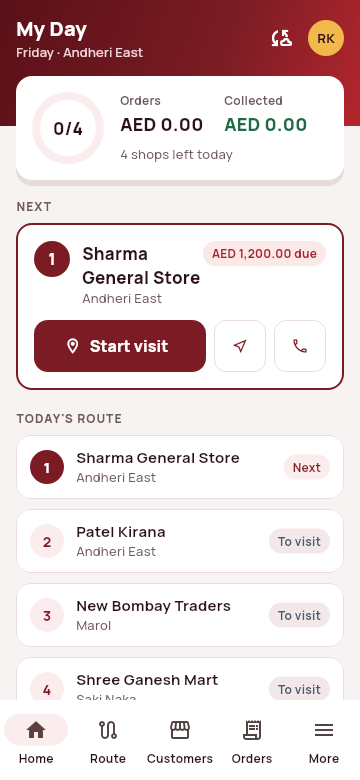 | 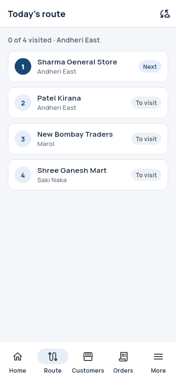 | 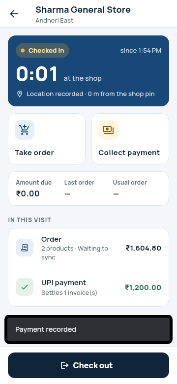 | 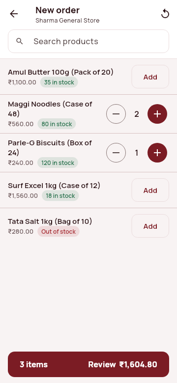 | 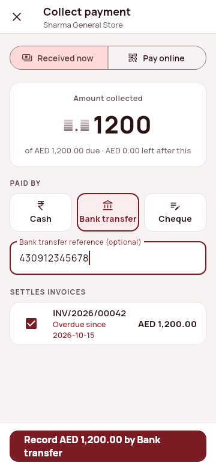 | 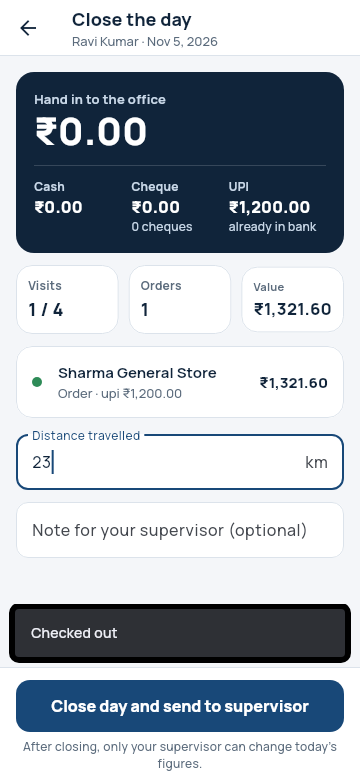 |

| Load the van | Van stock | Delivery choice | Take back goods | Unload the van | Supervisor dashboard |
| --- | --- | --- | --- | --- | --- |
| 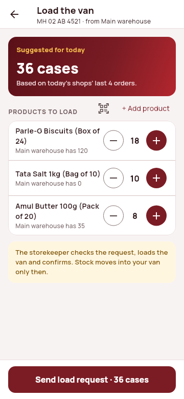 | 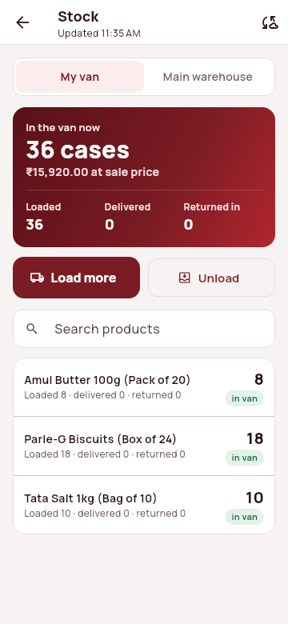 | 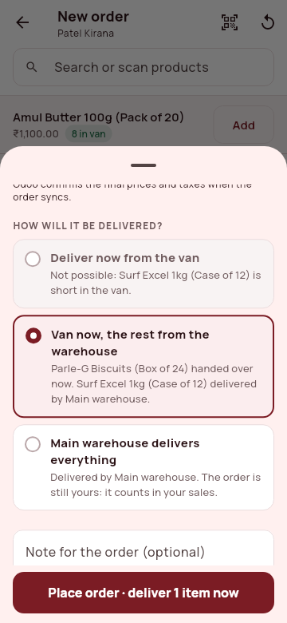 | 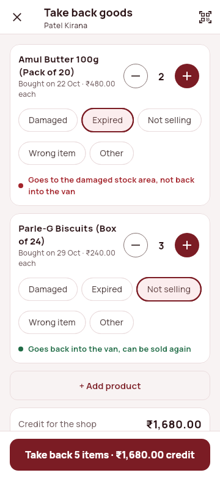 | 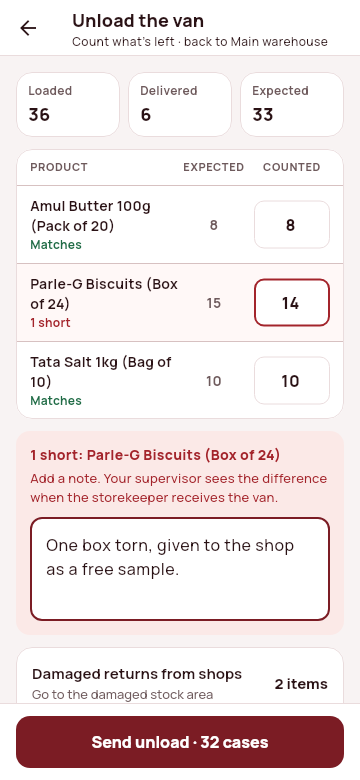 | 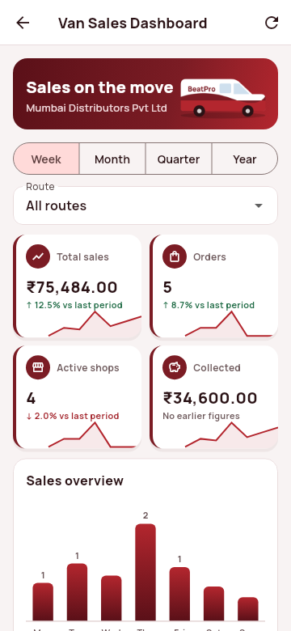 |

## What a rep can do

- **Sign in** with the Odoo address and the rep's Odoo email (or username) and password. Odoo checks
  them and gives the phone an API key of its own; the password is not kept on the phone. The key is
  listed on the user's Odoo profile (Security tab) as "BeatPro app · <phone>", where it can be
  revoked, and lasts a year (system parameter `beatpro_field_sales.app_key_days`). Users with
  two-step sign-in paste an API key instead. **More > Sign in again** renews an expired or revoked
  sign-in without losing work on the phone.
  Only users in the BeatPro Rep or Supervisor group can sign in.
- **My Day** (home): progress ring with the day's orders and collections, the next shop with Start visit,
  directions and call, and today's route with each shop's status.
- **Today's route**: customers from the rep's routes for today's weekday, in visit order.
- **Visit**: check in and out with GPS, a live timer and the distance from the shop pin; Take order and
  Collect payment tiles; the customer's amount due, last and usual order; record the result and,
  for no order, the reason.
- **Order**: catalogue with the customer's price-list prices and stock, quantity steppers,
  discounts, repeat last order, tax estimate. Discounts above the rep's limit go to a
  supervisor for approval in Odoo.
- **Collect payment**, two ways:
  - **Received now**: the payment methods your company set up in Odoo for reps (for example Cash,
    UPI, Cheque, Bank transfer), with a transaction ID or cheque details where Odoo asks for them,
    against the customer's open invoices. Works offline.
  - **Pay online**, when an online payment provider (Razorpay, Stripe…) is enabled in Odoo: a QR
    code and shareable link for one invoice; the customer pays on their phone and **Check payment**
    confirms Odoo marked the invoice paid. Needs signal.
- **Van sales**, for reps with a van in Odoo:
  - **Load the van**: today's suggested load (from the route's shops' last orders), sent to the
    storekeeper, or loaded straight away for reps who load their own van.
  - **Stock**: what is in the van now (loaded, delivered, taken back, left) and what the main
    warehouse has. Counts what the rep did offline.
  - **Delivery choice** on each order: from the van now, the van now and the rest from the main
    warehouse, or all from the main warehouse. The order is the rep's sale every way.
  - **Take back goods** during a visit, with a reason: resellable goods go back into the van,
    damaged and expired goods to the damaged area; the shop gets a credit note in Odoo.
  - **Unload the van** at day end: count what is left; a difference needs a note.
- **Van Sales Dashboard**, for supervisors when the BeatPro Theme is installed in Odoo: sales,
  orders, active shops and collections against the previous period, sales by day, category,
  shop and route, collected against still due, and recent activity. Needs signal.
- **Barcode scanning** on New order, Load the van, Take back goods and Unload the van: the scan button
  opens the camera and keeps scanning; each scan adds the product (by its Barcode in Odoo, or its
  Internal Reference) or one more of it. On Unload, scanning counts the boxes left. Handheld and
  Bluetooth scanners work too: they type the code into the search box and press Enter. Works offline.
- **New customer** with a GPS pin.
- **My orders** with Odoo's status (confirmed, waiting for approval).
- **Close the day**: the cash and cheques to hand in, bank and UPI payments already in the bank, visits and orders, a recap
  of each shop and the distance travelled.
- **Sync** screen: what's waiting, what failed and why.

The app uses the BeatPro Van Sales colours (maroon, `lib/src/theme.dart`), logo, app icon and van
drawing (`assets/images/`), the same as the BeatPro Theme in Odoo. The app uses the Manrope typeface (SIL Open Font License, `assets/fonts/OFL.txt`), the same as the
BeatPro screens in Odoo.

## How sync works

- Downloads: the rep's context, today's plan, customers, products with stock, price-list
  prices, taxes and open invoices (`lib/src/core/sync_service.dart`).
- Uploads in order: new customers, visits (once checked out), orders, payments, then the
  day-end close. Each record carries a UUID, so a sync cut off half way can run again
  without creating duplicates in Odoo.
- Odoo is the source of truth for prices and taxes: the phone shows an estimate and
  replaces it with Odoo's total after sync.

## Develop

```bash
flutter pub get
flutter analyze
flutter test                      # screen flow tests against a fake Odoo
```

Against a real Odoo 19 server with the module installed, as a rep (login and password, or
`BEATPRO_ODOO_KEY=<API key>` instead):

```bash
BEATPRO_ODOO_URL=http://127.0.0.1:8069 BEATPRO_ODOO_DB=mydb \
  BEATPRO_ODOO_LOGIN=rep@example.com BEATPRO_ODOO_PASSWORD=... \
  flutter test test/sync_integration_test.dart
```

Refresh the screenshots:

```bash
BEATPRO_SCREENSHOTS=1 flutter test test/app_flow_test.dart --update-goldens
```

Build: `flutter build apk --release` (Android) or `flutter build ipa` (iOS, on a Mac).
Before publishing, set the app icon, the Android signing key and the iOS bundle ID.

## Code layout

```text
lib/
  main.dart                 opens the local database, restores the session
  src/app.dart              navigation (go_router) and bottom tabs
  src/providers.dart        app state (Riverpod)
  src/core/odoo_client.dart Odoo 19 JSON-2 API client
  src/core/local_db.dart    SQLite storage on the phone
  src/core/repository.dart  what a rep does: visits, orders, payments, day close
  src/core/sync_service.dart upload and download
  src/screens/              one file per screen
```
