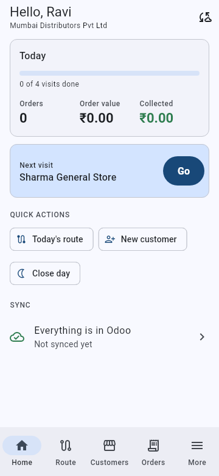
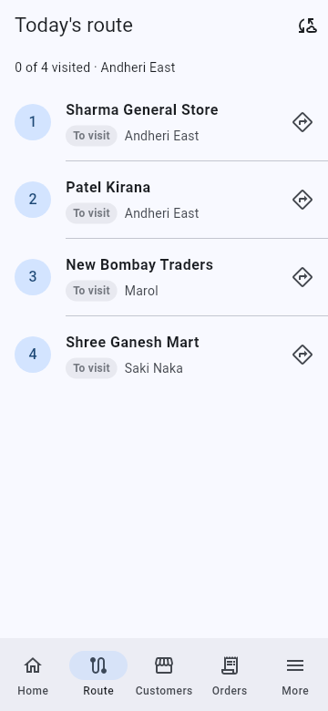
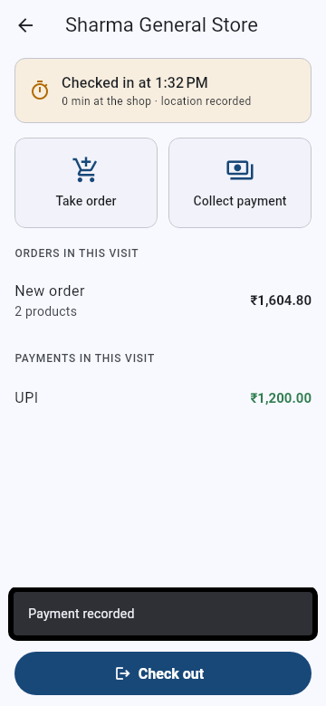
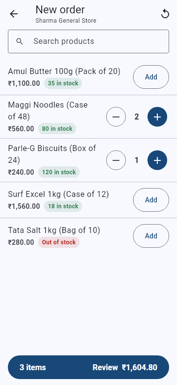
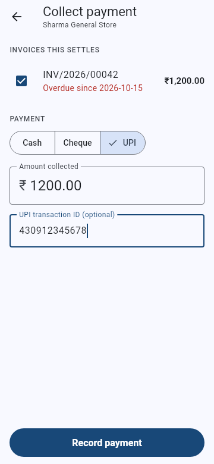
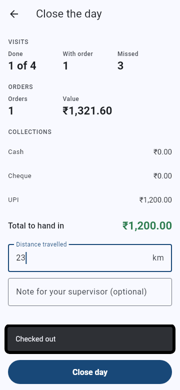

# BeatPro mobile app

Flutter app for field sales reps working with Odoo 19 Community and the
`beatpro_field_sales` module (branch `beatproodoo`). It works offline: everything a rep
does is saved on the phone and sent to Odoo when there's signal.

| Home | Today's route | Visit | New order | Collect payment | Close the day |
| --- | --- | --- | --- | --- | --- |
|  |  |  |  |  |  |

## What a rep can do

- **Sign in** with the Odoo address and an API key (Odoo: profile > Security > New API Key).
  Only users in the BeatPro Rep or Supervisor group can sign in.
- **Today's route**: customers from the rep's routes for today's weekday, in visit order, with directions.
- **Visit**: check in and out with GPS; take orders and collect payments during the visit;
  record the result and, for no order, the reason.
- **Order**: catalogue with the customer's price-list prices and stock, quantity steppers,
  discounts, repeat last order, tax estimate. Discounts above the rep's limit go to a
  supervisor for approval in Odoo.
- **Collect payment**: cash, cheque (number and date) or UPI (transaction ID) against the
  customer's open invoices.
- **New customer** with a GPS pin.
- **My orders** with Odoo's status (confirmed, waiting for approval).
- **Close the day**: visits, orders and collections by method, distance travelled.
- **Sync** screen: what's waiting, what failed and why.

## How sync works

- Downloads: the rep's context, today's plan, customers, products with stock, price-list
  prices, taxes and open invoices (`lib/src/core/sync_service.dart`).
- Uploads in order: new customers, visits (once checked out), orders, payments, then the
  day-end close. Each record carries a UUID, so a sync cut off half way can run again
  without creating duplicates in Odoo.
- Odoo is the source of truth for prices and taxes: the phone shows an estimate and
  replaces it with Odoo's total after sync.

## Develop

```bash
flutter pub get
flutter analyze
flutter test                      # screen flow tests against a fake Odoo
```

Against a real Odoo 19 server with the module installed and a rep's API key:

```bash
BEATPRO_ODOO_URL=http://127.0.0.1:8069 BEATPRO_ODOO_DB=mydb BEATPRO_ODOO_KEY=... \
  flutter test test/sync_integration_test.dart
```

Refresh the screenshots:

```bash
BEATPRO_SCREENSHOTS=1 flutter test test/app_flow_test.dart --update-goldens
```

Build: `flutter build apk --release` (Android) or `flutter build ipa` (iOS, on a Mac).
Before publishing, set the app icon, the Android signing key and the iOS bundle ID.

## Code layout

```text
lib/
  main.dart                 opens the local database, restores the session
  src/app.dart              navigation (go_router) and bottom tabs
  src/providers.dart        app state (Riverpod)
  src/core/odoo_client.dart Odoo 19 JSON-2 API client
  src/core/local_db.dart    SQLite storage on the phone
  src/core/repository.dart  what a rep does: visits, orders, payments, day close
  src/core/sync_service.dart upload and download
  src/screens/              one file per screen
```
